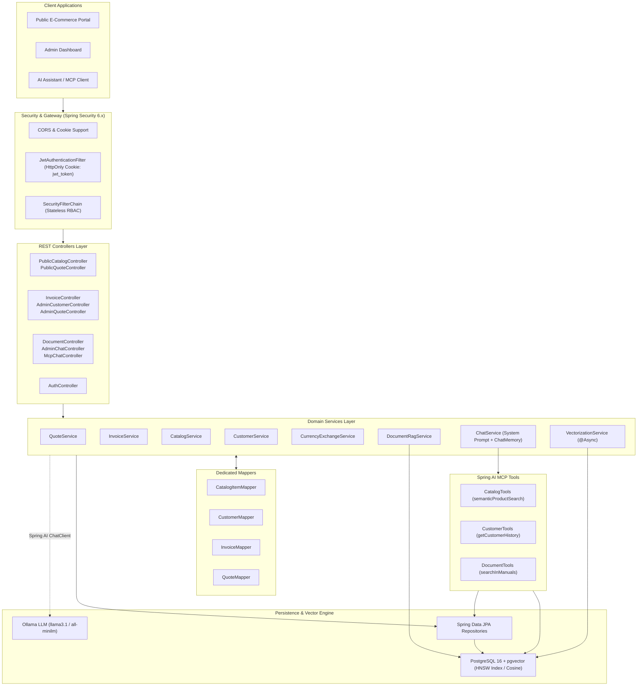
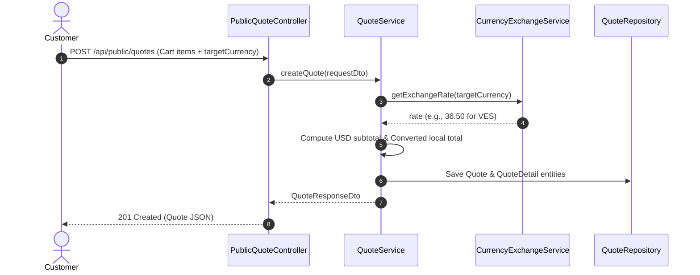
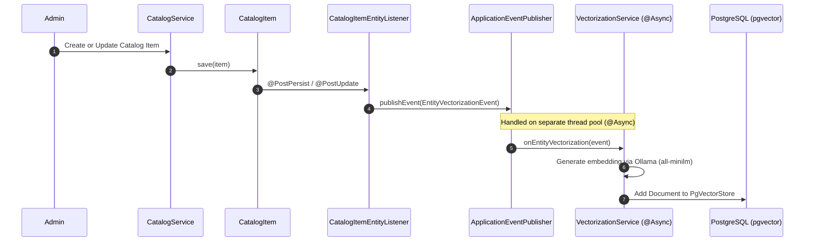
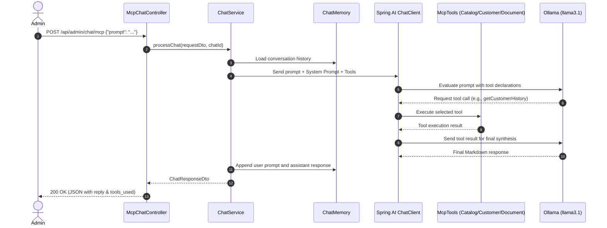

# EXTIN - Fire Safety Management & AI Backend

[](https://openjdk.org/projects/jdk/25/)
[](https://spring.io/projects/spring-boot)
[](https://spring.io/projects/spring-ai)
[](https://github.com/pgvector/pgvector)
[]()

Enterprise backend service for **EXTIN**, an integrated platform for fire protection equipment management, multi-currency commercial quoting, fiscal invoicing, document RAG (Retrieval-Augmented Generation), and an AI Assistant powered by Spring AI and the Model Context Protocol (MCP).

---

## Table of Contents
- [1. Business Domain & Context](#1-business-domain--context)
- [2. System Architecture](#2-system-architecture)
  - [2.1 Architectural Blueprint](#21-architectural-blueprint)
  - [2.2 Layered Design Pattern](#22-layered-design-pattern)
  - [2.3 Multi-Currency Engine](#23-multi-currency-engine)
  - [2.4 Real-Time Asynchronous Vectorization](#24-real-time-asynchronous-vectorization)
  - [2.5 Document RAG & Vector Isolation](#25-document-rag--vector-isolation)
  - [2.6 Model Context Protocol (MCP) AI Assistant](#26-model-context-protocol-mcp-ai-assistant)
  - [2.7 Stateless Security & RBAC](#27-stateless-security--rbac)
- [3. Technology Stack](#3-technology-stack)
- [4. Project Structure](#4-project-structure)
- [5. API Reference](#5-api-reference)
  - [5.1 Authentication Endpoints](#51-authentication-endpoints)
  - [5.2 Public Web Endpoints](#52-public-web-endpoints)
  - [5.3 Commercial & Invoicing Endpoints](#53-commercial--invoicing-endpoints)
  - [5.4 Customer Management Endpoints](#54-customer-management-endpoints)
  - [5.5 Document RAG & AI Assistant Endpoints](#55-document-rag--ai-assistant-endpoints)
- [6. Database Model & Seeding](#6-database-model--seeding)
- [7. Getting Started](#7-getting-started)
  - [7.1 Prerequisites](#71-prerequisites)
  - [7.2 Infrastructure Setup (Docker & Ollama)](#72-infrastructure-setup-docker--ollama)
  - [7.3 Running the Application](#73-running-the-application)
  - [7.4 Running Automated Tests](#74-running-automated-tests)

---

## 1. Business Domain & Context

**EXTIN** specializes in the distribution, installation, maintenance, and technical certification of fire safety equipment across South American markets (Venezuela and Brazil). The system addresses key operational challenges:

1. **Equipment & Maintenance Tracking**:
   - Manages physical equipment installed at customer facilities (PQS, $CO_2$, Solkaflam, Water extinguishers, fire hose cabinets, valves, smoke detectors).
   - Monitors hydro-static testing cycles and expiration dates, generating alerts for preventive refills and maintenance.
2. **Multi-Currency Commercial Lifecycle**:
   - Operates with **USD** as the standard base reference currency.
   - Calculates real-time conversions to **VES** (Venezuelan Bolívares via BCV official benchmark) and **BRL** (Brazilian Reais).
   - Converts shopping cart quotes into immutable fiscal invoices locked with payment references and daily exchange rates.
3. **Automated Fire Safety Advisory via AI**:
   - Incorporates NFPA and COVENIN fire code standards through Document RAG.
   - Provides an AI Copilot for administrators and technical staff with access to customer history, catalog recommendations, and technical regulations.

---

## 2. System Architecture

### 2.1 Architectural Blueprint



---

### 2.2 Layered Design Pattern

The application strictly adheres to a **Clean Layered Architecture**:
- **Controllers (`controllers/`)**: Expose RESTful endpoints, validate incoming request bodies (`@Valid`), negotiate content, and handle HTTP status codes. Controllers return DTO records exclusively.
- **DTOs (`models/dtos/`)**: Immutable Java `record` implementations reflecting API contracts. Internal audit fields and sensitive data (e.g., password hashes) are excluded.
- **Mappers (`mappers/`)**: Dedicated `@Component` beans providing explicit, bidirectional transformations between JPA Entities and DTO records.
- **Services (`services/`)**: Encapsulate all business logic, transactional boundaries (`@Transactional`), domain validations, and orchestration between repositories and AI components.
- **Repositories (`repositories/`)**: Interfaces extending Spring Data `JpaRepository<T, ID>` with custom derived query methods.
- **Entities (`models/entities/`)**: Relational JPA models inheriting from `Auditory` mapped superclass for automated audit trails (`@CreatedBy`, `@CreatedDate`, `@LastModifiedBy`, `@LastModifiedDate`).

---

### 2.3 Multi-Currency Engine

To maintain financial accuracy across volatile currency environments:
1. All catalog items store their authoritative unit price in **USD** (`base_price`).
2. Quotes accept a `target_currency` (`USD`, `VES`, or `BRL`).
3. Total amounts are calculated using arbitrary-precision arithmetic (`BigDecimal`, scale 4):
   $$\text{total\_amount\_usd} = \sum_{i=1}^{n} (\text{unit\_price\_usd}_i \times \text{quantity}_i)$$
   $$\text{total\_amount\_local} = \text{total\_amount\_usd} \times \text{exchange\_rate}$$
4. Upon settlement, the generated `Invoice` and its `InvoiceDetail` lines freeze the exact `exchange_rate`, `rate_date`, and `payment_reference`, guaranteeing fiscal immutability.



---

### 2.4 Real-Time Asynchronous Vectorization

Whenever products or services are added or modified, the search embeddings are automatically kept in sync without blocking the caller thread:



---

### 2.5 Document RAG & Vector Isolation

Manuals, safety guidelines, and municipal fire regulations (e.g., NFPA 10, COVENIN 1040) are uploaded in PDF format:
1. `DocumentController` receives multipart PDF uploads.
2. `DocumentRagService` extracts text using Apache PDFBox `PagePdfDocumentReader`.
3. The content is partitioned into semantic chunks using `TokenTextSplitter`.
4. Prior vectors under the same category are purged to ensure clean updates.
5. All document vectors are tagged with `domain = 'DOCUMENT'`.
6. When `DocumentTools.searchInManuals` executes, it applies an explicit filter:
   ```java
   new FilterExpressionBuilder().eq("domain", "DOCUMENT").build()
   ```
   This isolates normative document searches from catalog product embeddings.

---

### 2.6 Model Context Protocol (MCP) AI Assistant

The AI Copilot is orchestrated via Spring AI 2.0.x with the following structure:
- **System Prompt**: Defines strict boundary constraints (the agent strictly declines questions unrelated to fire safety or EXTIN operations), enforces Markdown formatting, and specifies tool selection criteria.
- **ChatMemory**: Rolling in-memory conversation buffer maintaining up to 20 dialogue turns per session.
- **MCP Domain Tools**:
  - `semanticProductSearch`: Embeds natural language queries and matches catalog equipment using cosine similarity.
  - `getCustomerHistory`: Performs exact fiscal lookup of customer information and equipment maintenance records by Tax ID / RIF.
  - `searchInManuals`: Queries vectorized technical documents and fire codes.



---

### 2.7 Stateless Security & RBAC

- **JWT in HttpOnly Cookie**: The authentication token is issued as an `HttpOnly`, `SameSite=Lax`, `Path=/` cookie (`jwt_token`), completely preventing client-side JavaScript access and XSS token theft.
- **Session Management**: Configured as `SessionCreationPolicy.STATELESS`.
- **CORS Configuration**: Explicitly permits credentials (`allowCredentials = true`) to support cookie delivery across trusted frontends.
- **Role Hierarchy**:
  - `ADMIN`: Full access to customer records, commercial invoicing, document uploads, and MCP assistant.
  - `USER`: Access to public catalog, quote calculation, and authenticated assistant queries.

---

## 3. Technology Stack

| Category | Technology | Version / Specification |
| :--- | :--- | :--- |
| **Language** | Java | 25 (OpenJDK / Amazon Corretto) |
| **Framework** | Spring Boot | 4.1.1 |
| **Persistence** | Spring Data JPA / Hibernate | 6.x / 7.x |
| **Database** | PostgreSQL + pgvector | 16-alpine with pgvector 0.1.6+ |
| **Security** | Spring Security + JJWT | 6.x / JJWT 0.12.6 |
| **AI Framework** | Spring AI | 2.0.1 |
| **LLM Inference** | Ollama | `llama3.1` |
| **Embedding Model** | Ollama | `all-minilm` (384 dimensions) |
| **Document Processing** | Apache PDFBox | 3.0.7 (`spring-ai-pdf-document-reader`) |
| **Build Tool** | Apache Maven | 3.9+ (via bundled `./mvnw`) |
| **Containerization** | Docker & Docker Compose | Compose v2 |

---

## 4. Project Structure

```
com.extin.backend/
├── BackendExtinApplication.java            # Main application bootstrap
├── config/                                 # Configuration & Seeders
│   ├── AuditorAwareImpl.java               # JPA Auditing principal resolver
│   ├── DatabaseSeeder.java                 # Startup database seeder
│   ├── DataInitializer.java                # Vector store seeder
│   └── JpaConfig.java                      # JPA Auditing enablement
├── controllers/                            # REST API Endpoints
│   ├── AdminChatController.java            # Legacy admin chat endpoint
│   ├── AdminCustomerController.java        # Customer management endpoint
│   ├── AdminQuoteController.java           # Quote administrative oversight
│   ├── AuthController.java                 # Login, logout & session validation
│   ├── DocumentController.java             # PDF RAG ingestion endpoint
│   ├── InvoiceController.java              # Invoicing & settlement endpoints
│   ├── McpChatController.java              # Advanced MCP AI assistant endpoint
│   ├── PublicCatalogController.java        # Public catalog listing
│   └── PublicQuoteController.java          # Public quote calculator
├── events/                                 # Event-Driven Architecture
│   └── EntityVectorizationEvent.java       # Asynchronous vectorization event
├── exceptions/                             # Centralized Exception Handling
│   ├── GlobalExceptionHandler.java         # RestControllerAdvice error handler
│   └── ResourceNotFoundException.java      # 404 Domain exception
├── mappers/                                # Entity <-> DTO Mappers
│   ├── CatalogItemMapper.java
│   ├── CustomerMapper.java
│   ├── InvoiceMapper.java
│   └── QuoteMapper.java
├── mcp/                                    # Model Context Protocol Components
│   ├── client/config/
│   │   └── McpClientConfig.java            # ChatMemory configuration
│   └── server/tools/
│       ├── CatalogTools.java               # Tool: semanticProductSearch
│       ├── CustomerTools.java              # Tool: getCustomerHistory
│       └── DocumentTools.java              # Tool: searchInManuals
├── models/                                 # Domain Model
│   ├── dtos/                               # Immutable DTO records
│   ├── entities/                           # JPA Entities with Auditory base
│   └── enums/                              # ItemType, QuoteStatus, InvoiceStatus, Role
├── repositories/                           # Spring Data JPA Repositories
├── security/                               # Security Components
│   ├── JwtAuthenticationFilter.java        # HttpOnly cookie JWT extractor
│   ├── JwtService.java                     # Token builder & parser
│   ├── SecurityBeansConfig.java            # PasswordEncoder & AuthManager
│   ├── SecurityConfig.java                 # SecurityFilterChain & CORS
│   └── UserDetailsServiceImpl.java         # UserDetailsService implementation
└── services/                               # Business Logic Services
    ├── CatalogService.java
    ├── ChatService.java
    ├── CurrencyExchangeService.java
    ├── CustomerService.java
    ├── DocumentRagService.java
    ├── InvoiceService.java
    ├── QuoteService.java
    └── VectorizationService.java
```

---

## 5. API Reference

### 5.1 Authentication Endpoints

| Method | Endpoint | Access | Description |
| :--- | :--- | :--- | :--- |
| `POST` | `/api/auth/login` | Public | Authenticates credentials; sets secure `HttpOnly` `jwt_token` cookie. |
| `POST` | `/api/auth/logout` | Authenticated | Clears the `jwt_token` cookie. |
| `GET` | `/api/auth/me` | Authenticated | Returns identity and role of the authenticated session. |

### 5.2 Public Web Endpoints

| Method | Endpoint | Access | Description |
| :--- | :--- | :--- | :--- |
| `GET` | `/api/public/catalog` | Public | Paginated catalog listing (parameters: `search`, `type`, `page`, `size`, `sort`). |
| `POST` | `/api/public/quotes` | Public | Submits cart items, calculates multi-currency totals, and creates quote. |
| `GET` | `/api/public/quotes/{id}` | Public | Retrieves specific quote details by UUID. |

### 5.3 Commercial & Invoicing Endpoints

| Method | Endpoint | Access | Description |
| :--- | :--- | :--- | :--- |
| `GET` | `/api/admin/quotes` | `ADMIN` | Paginated list of quotes with optional `status` filter (`PENDING`, `APPROVED`, etc.). |
| `POST` | `/api/admin/invoices/pay-and-issue/{quote_id}` | `ADMIN` | Issues immutable paid invoice upon payment notification. |
| `POST` | `/api/admin/invoices/from-quote/{quote_id}` | `ADMIN` | Converts approved quote to invoice with unique fiscal control number. |
| `GET` | `/api/admin/invoices` | `ADMIN` | Paginated list of all invoices. |
| `GET` | `/api/admin/invoices/{id}` | `ADMIN` | Single invoice details by UUID. |

### 5.4 Customer Management Endpoints

| Method | Endpoint | Access | Description |
| :--- | :--- | :--- | :--- |
| `GET` | `/api/admin/customers` | `ADMIN` | Paginated customer search by business name or Tax ID (`query`). |

### 5.5 Document RAG & AI Assistant Endpoints

| Method | Endpoint | Access | Description |
| :--- | :--- | :--- | :--- |
| `POST` | `/api/admin/documents/upload` | `ADMIN` | Multipart PDF upload. Chunks and indexes into `pgvector` (`domain = 'DOCUMENT'`). |
| `POST` | `/api/admin/chat` | `ADMIN` | Standard AI assistant endpoint with domain tools. |
| `POST` | `/api/admin/chat/mcp` | `ADMIN`, `USER` | Advanced MCP AI Assistant with conversation state (`X-Chat-Id` header). |

---

## 6. Database Model & Seeding

### Initial Seed Data
The application includes automated startup seeders (`DatabaseSeeder` and `DataInitializer`):
- **50 Realistic Customers**: 25 Venezuelan entities with valid RIF formats (`J-`, `V-`, `G-`) and 25 Brazilian entities with CNPJ formats.
- **Customer Equipment**: Physical equipment registered to customers, including active equipment and expired extinguishers designed to validate maintenance alert queries.
- **20 Catalog Items**: 12 fire safety products (extinguishers PQS/CO2/Solkaflam/Water, cabinets, hoses, detectors, valves) and 8 maintenance services.
- **Seed Users**:
  - `admin` (Password: `admin123`, Role: `ADMIN`)
  - `user` (Password: `user123`, Role: `USER`)

---

## 7. Getting Started

### 7.1 Prerequisites
- **Java 25 SDK** (Amazon Corretto 25 or Eclipse Temurin 25 recommended)
- **Docker & Docker Compose**
- **Ollama** installed locally (or accessible over network)

### 7.2 Infrastructure Setup (Docker & Ollama)

1. **Start PostgreSQL with pgvector**:
   ```bash
   docker compose up -d
   ```
   *This starts PostgreSQL 16 on port `5433` with database `fire_safety_db` and user `admin`.*

2. **Pull Ollama Models**:
   Ensure Ollama is running (`http://localhost:11434`) and pull the required models:
   ```bash
   ollama pull llama3.1
   ollama pull all-minilm
   ```

### 7.3 Running the Application

Use the Maven Wrapper included in the project repository:

- **Linux / macOS**:
  ```bash
  ./mvnw spring-boot:run
  ```

- **Windows**:
  ```powershell
  .\mvnw.cmd spring-boot:run
  ```

The server will initialize on port **`8090`** (configured in `src/main/resources/application.yml`).

### 7.4 Running Automated Tests

The test suite validates controller contracts, security filters, JWT tokens, RAG document processing, and JPA auditing across 72 test cases:

```bash
./mvnw test
```

---

## License
Proprietary software developed for EXTIN Fire Safety Management. All rights reserved.
